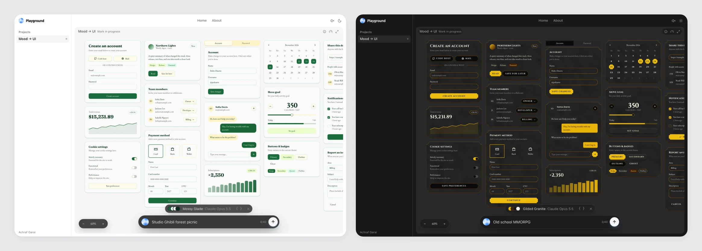

<div align="center">

# Achraf Garai · Playground

**A design engineering playground.** Small, self-contained demos in one static web app, each on its own page, ready to share or record.

React 19 · React Router 7 · Tailwind CSS 4 · Motion · shadcn/ui · Cloudflare Pages

[playground.achrafgarai.com](https://playground.achrafgarai.com)

<br />



</div>

<br />

## Highlights

| | |
|---|---|
| **Mood → UI** | Type a mood, a brand or a world in a few words. An AI first describes how the reference really looks, then picks a shadcn theme: colours from the Tailwind palette, a heading font, radius and a few style switches (shape, border, texture, caps, depth). Every request varies, and signature brand colours are kept. |
| **Accessible by design** | A contrast guard checks every AI theme against WCAG 2.2 AA and nudges colours along their palette scale until they pass. Body text is limited to six polished faces. |
| **Figma-like canvas** | Fifteen stock shadcn/ui cards on a pan and zoom canvas: Ctrl or ⌘ + scroll to zoom, Space or middle-drag to pan, Shift + 1 to fit. |
| **Copy the config** | The `{ }` button shows the theme as shadcn CSS variables, ready to paste into a project. |
| **Isolated demos** | Each demo lives in its own folder, loads as a lazy chunk, and styles only its own container. Isolation is tested. |
| **Light & dark** | Token-based shell themes with contrast pairs tested in both modes. |
| **Free to run** | Static prerender on Cloudflare Pages. The AI call runs in a Pages Function with a rate limit and an offline fallback, so the demo always answers. |

## Quick start

```bash
pnpm install
pnpm dev           # http://localhost:5173
pnpm build         # static site in build/client
pnpm preview       # serve the build locally
```

Node 22+ and pnpm. AI keys are optional: without them, Mood → UI uses a local Ollama model if one is running, then the offline generator.

## Add a demo

```bash
pnpm new:demo <slug> "<Title>"
```

This creates `app/demos/<slug>/meta.ts` and `index.tsx`. The registry, sidebar, home page and prerender list are generated, so there is nothing else to edit.

| Meta field | |
|---|---|
| `slug` | Folder name, kebab-case |
| `title`, `description`, `tags[]` | Shown in the sidebar, on the home page and in share cards |
| `order` | Position in the list |
| `status` | `"wip"` or `"ready"` |
| `stage` | `"light"` or `"ink"` full-screen background |
| `ogImage` | Optional, `/og/<slug>.png` |

**Rules.** A demo imports only from its own folder, `~/design-system` and `~/lib`. Its styles go on its container (`data-demo="<slug>"`), never on `:root`, `html` or `body`. Heavy libraries (three.js, Wasm, audio, AI models) are imported only inside the demo. Clean up with `useDemoLifecycle`.

## Mood → UI

```text
brief ──► reading ──► theme tokens ──► contrast guard ──► shadcn components
          (what it      (palette tokens,  (WCAG 2.2 AA,     (CSS variables
           refers to,    fonts, radius,    steps along the   + data attributes
           how it looks) style switches)   palette scale)    on the canvas)
```

1. **Read.** The model first writes what the brief refers to, its real visual language (colours, light, materials, lettering, interface) and how each part maps to the theme.
2. **Theme.** Colours are Tailwind palette tokens (`amber-500`), never hex. Each request gets a random creative direction so the same brief gives a fresh result; a recognisable reference keeps its look.
3. **Guard.** `guard.ts` checks every text and fill pair and fixes misses before anything is shown.
4. **Apply.** Tokens become shadcn CSS variables on the canvas. Fonts load lazily, one file per font.

The taste lives in `app/demos/mood-ui/design-guide.ts` (rules, fonts, palettes, examples). The prompt is in `server/prompt.ts`.

### AI providers

The first available provider answers; if one fails, the next one is tried.

| Order | Provider | Enabled by |
|---|---|---|
| Local only | Claude Opus 5.5 through the Claude Code CLI (your Claude login, no API key; can search the web) | `THEME_PROVIDER=claude` |
| 1 | OpenRouter (free model by default) | `OPEN_ROUTER_API_KEY`, optional `OPENROUTER_MODEL` |
| 2 | Gemini | `GEMINI_API_KEY`, optional `GEMINI_MODEL`; `THEME_PROVIDER=gemini` puts it first |
| 3 | Claude API | `ANTHROPIC_API_KEY` |
| 4 | Workers AI (Llama 3.3) | The `AI` binding on Cloudflare |
| 5 | Ollama | Running locally (`OLLAMA=off` to skip) |
| 6 | Offline generator | Always |

Keys go in `.env.local` (git-ignored) for local work, and as encrypted secrets in the Cloudflare Pages project for the live site. See `.env.example`.

**Protecting the quota.** The API accepts requests from the site's own origin only, allows 6 requests per visitor every 10 minutes and 500 a day in total, and the page allows 3 AI tries per session before switching to the offline generator. Local dev has no limits (`RATE_LIMIT=on` to test them).

## Project structure

```text
app/
├─ demos/
│  ├─ mood-ui/          Mood → UI: canvas, prompt bar, guard, palette, fonts, vendored shadcn/ui
│  └─ _template/        starting point for pnpm new:demo
├─ design-system/       tokens.css, portfolio.css, Orb, toggles, contrast pairs
├─ lib/                 registry, DemoContainer, useDemoLifecycle, theme, SEO
├─ routes/              home, about, p/:slug
└─ shell/               header, sidebar, layout, footer
functions/api/theme.ts  Cloudflare Pages Function for Mood → UI
server/                 shared AI logic (prompt, providers, rate limit), also served by the Vite dev middleware
scripts/                new-demo, demo discovery, postbuild (404 page and shell bundle size)
tests/  e2e/            Vitest unit tests and Playwright smoke tests
docs/                   design system reference and design decisions
```

## Design system

The look is copied from my [UX portfolio](https://work.achrafgarai.com). Before any UI work, read `docs/design-system-reference.md` and `docs/design-decisions.md` (the decisions file wins). Raw values live only in `tokens.css` and `portfolio.css`; components use tokens and utilities, and that is tested.

## Quality checks

```bash
pnpm check         # types, lint (Biome), unit tests (Vitest), build
pnpm test:e2e      # Playwright smoke tests
```

The build prints the shell bundle size, so growth is visible on every change.

## Deploy

Every push to `main` runs `pnpm check` in GitHub Actions and deploys `build/client` and `functions/` to Cloudflare Pages with Wrangler. The workflow needs two repository secrets, `CLOUDFLARE_API_TOKEN` (Cloudflare Pages: Edit) and `CLOUDFLARE_ACCOUNT_ID`.

<br />

<div align="center">
<sub>Designed and built by Achraf Garai.</sub>
</div>
